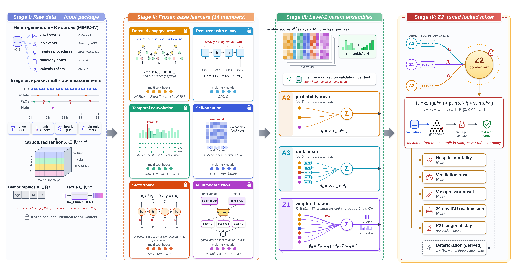
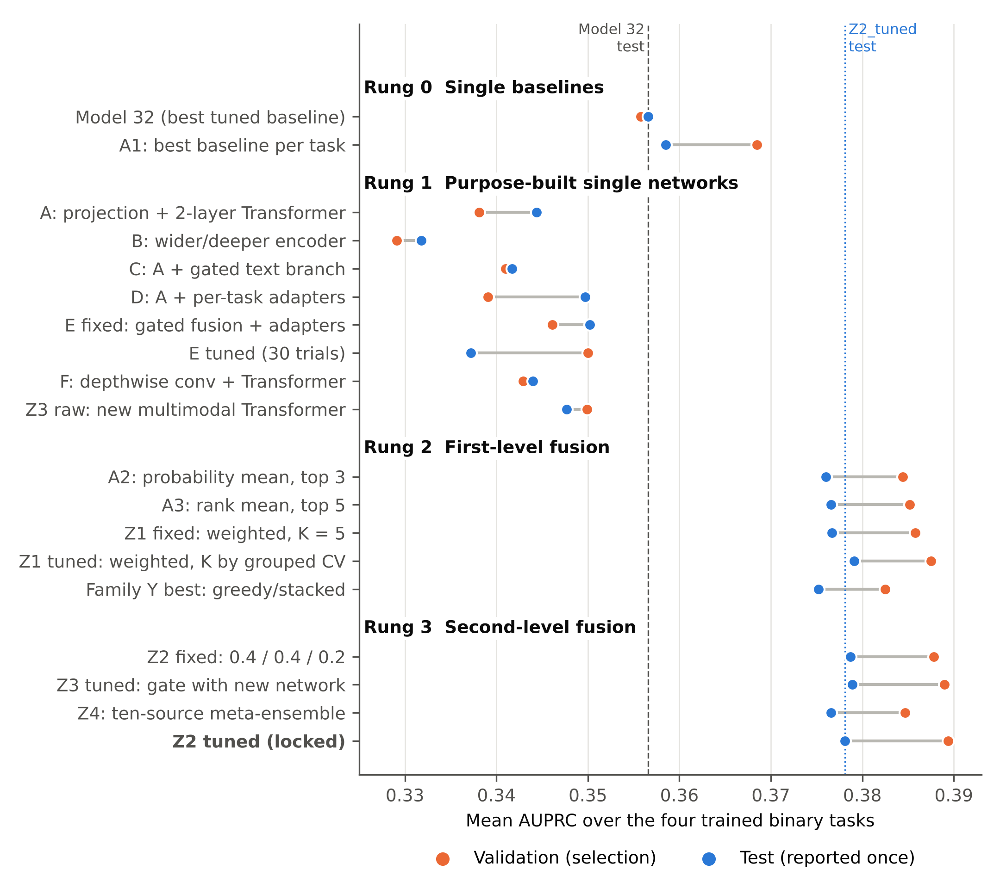

# Composition beats construction at 24 hours

**Fusing irregularly sampled records and radiology text for six-outcome ICU prediction from MIMIC-IV to 208 hospitals**

**Repository:** https://github.com/abdullah2025-source/icu-composition-24h

Code accompanying the article and PhD thesis *Multimodal ICU Prediction* (Centro de Investigación en Computación, Instituto Politécnico Nacional, Mexico).

> **No patient data is contained in this repository.** MIMIC-IV, MIMIC-IV-Note, MIMIC-III and eICU-CRD are credentialed PhysioNet databases and cannot be redistributed. Every script here reads the databases from your own local copy. Only aggregate results are included.

---

## What this repository does

At a single landmark — **24 hours after ICU admission** — the pipeline predicts six outcomes from the first day of a stay:

| Output | Type |
|---|---|
| In-hospital mortality | binary |
| Invasive ventilation onset (patients not yet ventilated) | binary |
| Vasopressor onset (patients not yet on vasopressors) | binary |
| 30-day ICU readmission | binary |
| Deterioration (noisy-OR of the three acute events) | derived |
| ICU length of stay | regression (hours) |

Inputs are a **110-channel hourly tensor** (28 variables × values, missingness masks, time since last measurement, 3-hour trends), demographics, and **Bio_ClinicalBERT embeddings of radiology reports** admitted by their store time, so that no information recorded after the landmark can leak in.



## Key results (MIMIC-IV test split, 14,887 stays)

| Finding | Evidence |
|---|---|
| The benchmark is flat at the top | 33 models, 7 families, 917 Optuna trials; tuned XGBoost 0.355 vs best multimodal network 0.357 mean AUPRC |
| Composition beats construction | Validation-locked fusion **Z2_tuned** raises mean AUPRC 0.357 → **0.378**; averaging three diverse members gives 81% of the gain; six purpose-built networks peak at 0.350 |
| Mortality | AUROC **0.890**, AUPRC **0.569**, ECE 0.013 |
| Better than clinical scores at the same landmark | Mortality AUROC 0.890 vs SOFA 0.734, OASIS 0.742, SAPS-II 0.776, APS-III 0.783; **APACHE IVa on eICU-CRD: 0.847 vs 0.832** |
| Frozen external transfer | MIMIC-III CareVue AUROC −0.017 to −0.041; eICU-CRD (208 hospitals) mortality 0.840, vasopressor onset 0.749 |
| Fairness | Similar performance across sex, race and insurance; lower discrimination at age ≥ 80 (mortality AUROC 0.841) |



## Repository layout

```
icu-composition-24h/
├── src/                     # all pipeline code (cohort, features, text, 33 baselines, fusion, evaluation, XAI, external validation)
├── configs/                 # selected hyperparameters and locked fusion recipes (no patient data)
├── results/                 # aggregate result tables only (no stay-level rows)
├── docs/figures/            # figures from the article
├── requirements.txt
├── CITATION.cff
└── LICENSE
```

## Reproducing the study

### 1. Data access
1. Complete the CITI "Data or Specimens Only Research" training and obtain credentialed access on [PhysioNet](https://physionet.org).
2. Download **MIMIC-IV v3.1**, **MIMIC-IV-Note v2.2**, **MIMIC-III v1.4** and **eICU-CRD v2.0**.
3. Set the paths to your local copies at the top of each script (or in `configs/`).

### 2. Environment
```bash
python3.10 -m venv venv && source venv/bin/activate
pip install -r requirements.txt
```
Experiments were run on Linux with one AMD Instinct MI210 GPU (ROCm 6.4); NVIDIA GPUs with CUDA also work. Tabular models run on CPU.

### 3. Pipeline order
| Step | What it does |
|---|---|
| 1. Cohort and labels | Adult stays ≥ 24 h, 24-h landmark, six targets with per-task validity masks, patient-level 70/10/20 split (seed 2026) |
| 2. Structured features | Event quality control, hourly grid, masks, time-since and trend channels; training-only statistics |
| 3. Radiology text | Store-time rule, frozen Bio_ClinicalBERT [CLS] embeddings, norm-softmax pooling |
| 4. Baselines | 33 models in 7 families, fixed and Optuna-tuned runs (seed 20260923) |
| 5. Proposed networks and fusion | Architectures A–F; ensembles A2, A3, Z1, Z2, Z3, Z4, Family Y; validation-locked selection |
| 6. Evaluation | Bootstrap CIs, DeLong, McNemar, paired bootstrap, Benjamini–Hochberg FDR |
| 7. Explainability | Ensemble-level Shapley, Tree SHAP, Integrated Gradients, temporal occlusion, MoE modality ablation |
| 8. External validation | Frozen transfer to MIMIC-III CareVue and eICU-CRD |
| 9. Severity scores and fairness | `src/severity_and_fairness_analysis.py` (scores built with [mimic-code](https://github.com/MIT-LCP/mimic-code) in DuckDB) |

All selection decisions are made on the validation split; the test split and external cohorts are read once, after everything is locked.

## Citation

If you use this code, please cite the article (details will be updated on publication):

```bibtex
@article{icu_composition_2027,
  title   = {Composition beats construction at 24 hours: Fusing irregularly sampled records and radiology text for six-outcome ICU prediction from MIMIC-IV to 208 hospitals},
  author  = {author = {Abdullah and Oropeza Rodríguez, José Luis and Sidorov, Grigori and Torres Ruiz, Miguel Jesús},
  url     = {https://github.com/abdullah2025-source/icu-composition-24h}
}
```

## License

Code is released under the MIT License (see `LICENSE`). The clinical databases remain subject to the PhysioNet Credentialed Health Data Use Agreement.

## Contact

[Abdullah] — Centro de Investigación en Computación (CIC), Instituto Politécnico Nacional, Mexico City · [abdullah2025@cic.ipn.mx]
